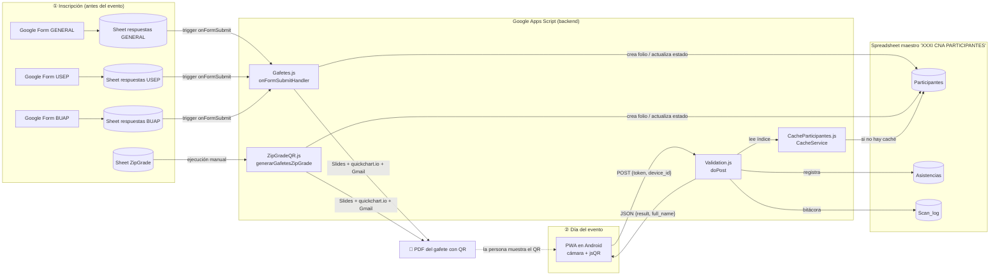
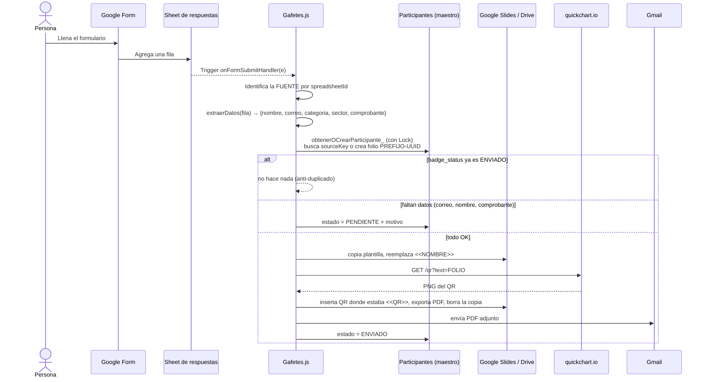
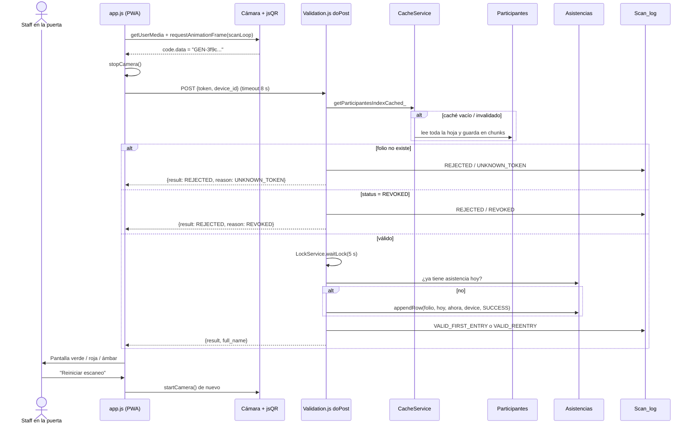
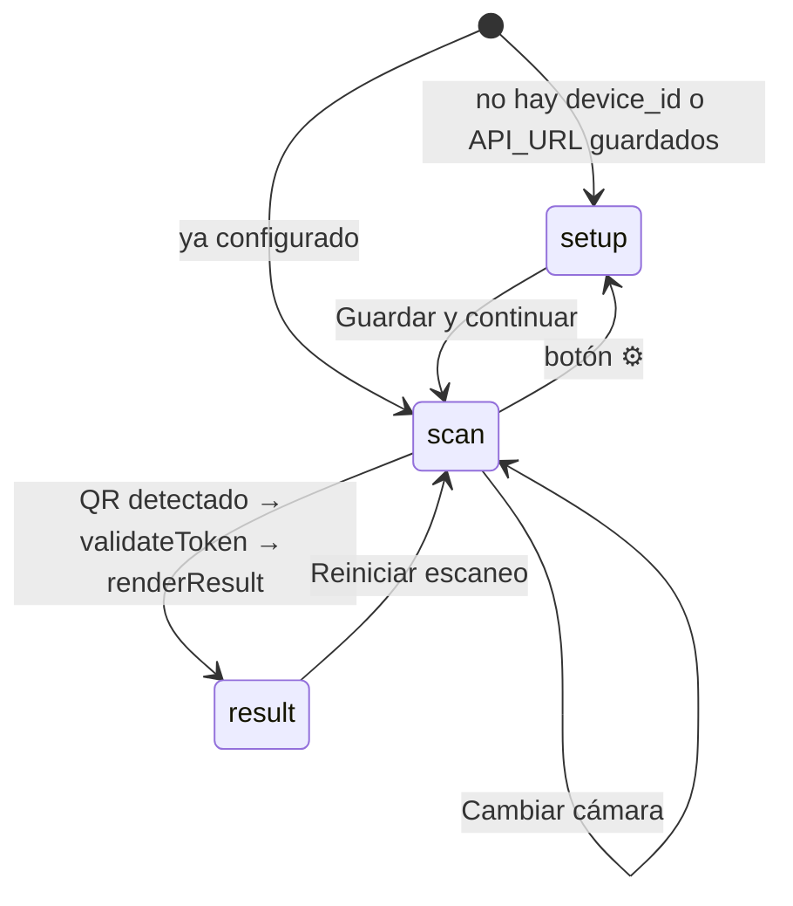
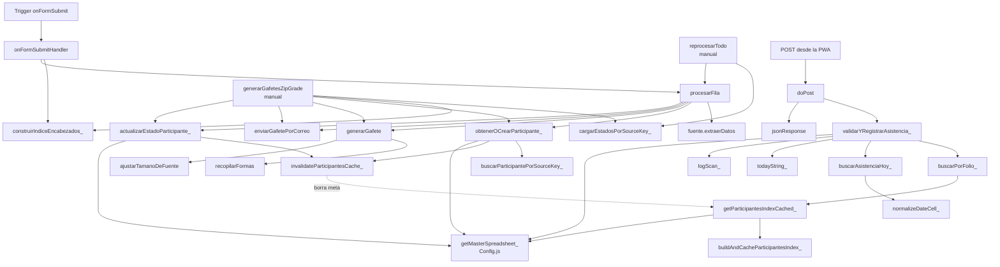
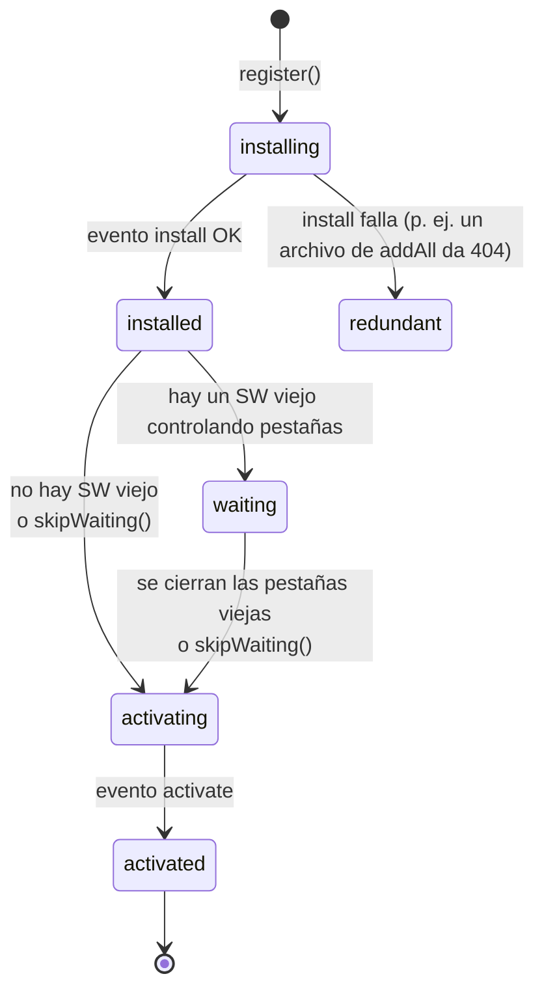

# Guía completa del proyecto — Control de Acceso por QR (PWA + Apps Script)

> Documento de estudio: explica **qué hace** el proyecto, **cómo fluye** la información de principio a fin, **para qué sirve cada archivo y cada función**, cómo se conectan entre sí y los **conceptos técnicos** que aparecen (Service Worker, caché, cámara, CORS, concurrencia, etc.), con ejemplos de código.

---

## Índice

1. [Visión general](#1-visión-general)
2. [Arquitectura en una imagen](#2-arquitectura-en-una-imagen)
3. [Mapa de archivos](#3-mapa-de-archivos)
4. [El flujo completo, de principio a fin](#4-el-flujo-completo-de-principio-a-fin)
5. [Frontend (la PWA) archivo por archivo](#5-frontend-la-pwa-archivo-por-archivo)
6. [Backend (Google Apps Script) archivo por archivo](#6-backend-google-apps-script-archivo-por-archivo)
7. [Cómo se relacionan los códigos](#7-cómo-se-relacionan-los-códigos)
8. [Conceptos importantes explicados](#8-conceptos-importantes-explicados)
9. [Observaciones e inconsistencias detectadas](#9-observaciones-e-inconsistencias-detectadas)
10. [Glosario rápido](#10-glosario-rápido)

---

## 1. Visión general

El proyecto resuelve el **control de acceso y el pase de lista** de un congreso (Congreso Nacional de Anatomía 2026). Tiene dos mitades que viven en lugares distintos:

| Mitad | Dónde corre | Qué hace |
|---|---|---|
| **Frontend — PWA de escaneo** (`index.html`, `js/`, `css/`, `sw.js`, `manifest.json`) | En el navegador de 3 teléfonos Android ubicados en la entrada (`AND-01`, `AND-02`, `AND-03`) | Abre la cámara, lee el QR del gafete, lo manda al servidor y muestra una pantalla completa **verde / roja / ámbar** con el resultado. |
| **Backend — Google Apps Script** (`apps-script/*.js`) | En los servidores de Google, ligado a Google Sheets, Slides, Drive y Gmail | 1) Cuando alguien se inscribe en un Google Form, **genera su gafete en PDF con un QR** y se lo manda por correo. 2) Expone un **endpoint web (`doPost`)** que valida el QR y registra la asistencia del día. |

La pieza que une ambas mitades es el **folio**: un identificador del tipo `GEN-3f9c1e2a-...` que:

1. se crea cuando la persona se inscribe,
2. se **codifica dentro del QR** del gafete,
3. la PWA lo **lee con la cámara** y lo envía como `token`,
4. el backend lo **busca** en la hoja maestra para decidir si deja pasar.

No hay build tools, ni npm, ni frameworks: el frontend son archivos estáticos y el backend son scripts de Apps Script.

---

## 2. Arquitectura en una imagen



---

## 3. Mapa de archivos

```
qr-scanner-pwa/
├── index.html               # Las 3 pantallas (configuración, escaneo, resultado) + carga de scripts
├── manifest.json            # Metadatos para que la web se "instale" como app (PWA)
├── sw.js                    # Service Worker: caché del "shell" de la app
├── css/styles.css           # Estilos: tema oscuro, cámara a pantalla completa, pantallas de color
├── js/config.js             # Constantes + lectura/escritura en localStorage
├── js/app.js                # Lógica: arranque, cámara, bucle de escaneo, fetch al API, render del resultado
├── README.md                # Instrucciones de instalación/despliegue
├── .gitignore               # Ignora la carpeta test/
└── apps-script/             # Backend (en Apps Script estos archivos se llaman .gs)
    ├── Config.js            # (MaestroConfig) ID del Sheet maestro, nombres de pestañas, índices de columnas, claves de caché
    ├── Setup.js             # (MaestroSetup) crea las 3 pestañas del maestro con encabezados — se corre 1 vez
    ├── Gafetes.js           # Trigger de Forms → crea participante → genera gafete PDF con QR → lo envía por correo
    ├── ZipGradeQR.js        # Lo mismo pero en lote, para un listado de ZipGrade (correo o carpeta de Drive)
    ├── CacheParticipantes.js# Caché en "chunks" del índice folio → nombre/estado
    ├── Validation.js        # (Validacion) doPost: valida el folio y registra asistencia con LockService
    ├── Consolidacion.js     # (MaestroConsolidacion) registrarEnMaestro_ — hoy ya no se llama (ver §9)
    └── README.md            # Versión anterior del README (desactualizada)
```

> **Nota sobre extensiones:** Apps Script guarda sus archivos como `.gs`; aquí están como `.js` (el último commit "se corrigió la extensión de los archivos"). Es el formato que usa, por ejemplo, la herramienta `clasp` para sincronizar Apps Script con un repo local. Dentro de un mismo proyecto de Apps Script **todos los archivos comparten el mismo ámbito global**, por eso `Validation.js` puede llamar a `getMasterSpreadsheet_()` definida en `Config.js` sin ningún `import`.

---

## 4. El flujo completo, de principio a fin

### 4.0 Preparación (una sola vez)

1. Crear el Google Sheet **"XXXI CNA PARTICIPANTES"** y pegar su ID en `MASTER_SPREADSHEET_ID` (`apps-script/Config.js:11`).
2. Pegar los `SPREADSHEET_ID` de cada Form en `FUENTES` (`apps-script/Gafetes.js:36`).
3. Ejecutar `setupHojasMaestras()` → crea las pestañas `Participantes`, `Asistencias`, `Scan_log`.
4. Ejecutar `crearActivadoresParaLos3Sheets()` → crea un *trigger* `onFormSubmit` por cada Sheet de respuestas.
5. Desplegar el proyecto como **Web App** → Google da una URL `https://script.google.com/macros/s/.../exec`.
6. Publicar la PWA en HTTPS (p. ej. GitHub Pages), abrirla en cada Android, elegir `AND-0X` y pegar la URL del Web App.

### 4.1 Fase A — Inscripción y envío del gafete



### 4.2 Fase B — Escaneo en la entrada



### 4.3 Máquina de estados de la PWA



---

## 5. Frontend (la PWA) archivo por archivo

### 5.1 `index.html`

Define **tres pantallas** como `<section>`; solo una es visible a la vez (las demás llevan la clase `hidden`):

| Pantalla | id | Contenido |
|---|---|---|
| Configuración | `#setup-screen` | `<select id="device-select">` (AND-01..03) + `<input id="api-url-input">` + botón guardar |
| Escaneo | `#scan-screen` | Barra superior (badge de conexión, "Cambiar cámara", badge del dispositivo, ⚙︎), `<video id="camera-feed">`, `<canvas id="scan-canvas" class="hidden">` y un marco visual `.scan-frame` |
| Resultado | `#result-screen` | Título, nombre, subtítulo y botón "Reiniciar escaneo" |

Detalles importantes:

- `<link rel="manifest" href="manifest.json">` → convierte el sitio en instalable.
- `<meta name="viewport" ... viewport-fit=cover>` → la app usa toda la pantalla, incluso bajo el "notch".
- `<video playsinline muted>` → **imprescindible** en móviles: sin `playsinline` iOS abriría el video en pantalla completa nativa; sin `muted` algunos navegadores bloquean el autoplay.
- El orden de los `<script>` **importa**: primero `jsQR` (librería desde unpkg), luego `config.js` (define `CONFIG` y funciones de storage), y al final `app.js`, que usa ambos. No son módulos ES, son scripts clásicos que comparten el ámbito global (`window`).

```html
<script src="https://unpkg.com/jsqr@1.4.0/dist/jsQR.js"></script> <!-- define window.jsQR -->
<script src="js/config.js"></script>                              <!-- define CONFIG, getApiUrl()... -->
<script src="js/app.js"></script>                                 <!-- los usa -->
```

### 5.2 `js/config.js`

Centraliza la configuración y encapsula `localStorage`:

```js
const CONFIG = {
  API_URL: "",                               // valor por defecto si no hay nada guardado
  DEVICE_IDS: ["AND-01", "AND-02", "AND-03"],
  STORAGE_KEYS: { DEVICE_ID: "congreso_device_id", API_URL: "congreso_api_url" },
  REQUEST_TIMEOUT_MS: 8000,                  // máximo de espera de la validación
  RESULT_DISPLAY_MS: 2500,                   // (no se usa actualmente, ver §9)
};
```

| Función | Qué hace |
|---|---|
| `getApiUrl()` | Devuelve la URL guardada en `localStorage`, o `CONFIG.API_URL` si no hay. |
| `setApiUrl(url)` | Guarda la URL (con `trim()`). |
| `getDeviceId()` | Devuelve el `device_id` guardado o `""`. |
| `setDeviceId(id)` | Guarda el `device_id`. |

Así, cada teléfono "recuerda" quién es (`AND-01`, etc.) y a qué servidor hablar, aunque se cierre la app.

### 5.3 `js/app.js` — el corazón del frontend

#### Estado global

```js
const els = { /* referencias a todos los elementos del DOM, buscadas una sola vez */ };
const canvasCtx = els.canvas.getContext("2d", { willReadFrequently: true });

let scanning = false;          // ¿el bucle de escaneo debe seguir?
let rafId = null;              // id del requestAnimationFrame para poder cancelarlo
let stream = null;             // MediaStream de la cámara
let currentFacingMode = "user";// "user" = cámara frontal, "environment" = trasera
```

Guardar los elementos en `els` evita llamar a `document.getElementById` en cada cuadro de video.

#### Funciones

| Función | Rol |
|---|---|
| `init()` | Punto de entrada (se ejecuta en `DOMContentLoaded`). Registra el Service Worker, pinta el badge de conexión y escucha `online/offline`, llena el `<select>`, decide si mostrar *setup* o *scan* y conecta todos los botones. |
| `populateDeviceSelect()` | Crea las `<option>` a partir de `CONFIG.DEVICE_IDS`, con un placeholder deshabilitado. |
| `onSetupSubmit(e)` | `preventDefault()` (evita recargar la página), guarda device y URL, actualiza el badge, cambia a *scan* y enciende la cámara. |
| `showScreen(name)` | Muestra una pantalla y oculta las otras con `classList.toggle("hidden", condición)`. |
| `updateConnectionBadge()` | Lee `navigator.onLine` y pinta "EN LÍNEA" / "SIN CONEXIÓN". |
| `startCamera()` | Verifica que `jsQR` haya cargado (si no, reintenta cada 3 s), espeja el video si es la cámara frontal, pide la cámara con `getUserMedia`, la conecta al `<video>` y arranca `scanLoop`. |
| `stopCamera()` | Detiene el bucle (`scanning=false`, `cancelAnimationFrame`) y **apaga físicamente** la cámara (`track.stop()`), lo que apaga el LED y libera batería. |
| `scanLoop()` | Cada cuadro: copia el video al canvas, extrae los píxeles y se los pasa a `jsQR`. Si encuentra un QR, para la cámara y llama a `validateToken`. Tiene `try/catch` para que un error en un cuadro no mate el bucle. |
| `validateToken(token)` | Hace el `POST` al Apps Script con timeout (`AbortController`), parsea el JSON y llama a `renderResult`. Cualquier fallo (timeout, HTTP no-OK, JSON roto) se convierte en `{ result: "ERROR" }`. |
| `renderResult(data)` | Traduce la respuesta del API a un estado visual (`STATES`): clase CSS de color, título, subtítulo y nombre. |
| `registerServiceWorker()` | Si el navegador lo soporta, registra `./sw.js`. |

#### Tabla de traducción API → pantalla (`renderResult`)

| `result` | `reason` | Color | Título | Subtítulo |
|---|---|---|---|---|
| `VALID_FIRST_ENTRY` | — | 🟩 verde | REGISTRO VÁLIDO | ASISTENCIA REGISTRADA |
| `VALID_REENTRY` | — | 🟩 verde | REGISTRO VÁLIDO | ASISTENCIA YA REGISTRADA HOY |
| `REJECTED` | `UNKNOWN_TOKEN` | 🟥 rojo | QR NO VÁLIDO | No permitir acceso |
| `REJECTED` | `REVOKED` | 🟥 rojo | QR CANCELADO | Escalar la incidencia |
| `REJECTED` | `UNPAID` | 🟧 ámbar | REGISTRO PENDIENTE DE PAGO | Canalizar a registro/pagos |
| `REJECTED` | `INCOMPLETE` | 🟧 ámbar | REGISTRO INCOMPLETO | Canalizar a registro |
| `REJECTED` | otro | 🟥 rojo | QR NO VÁLIDO | (el `reason`) |
| `ERROR` / cualquier otra cosa | — | 🟥 rojo | NO SE PUDO VALIDAR | REINTENTAR |

> `UNPAID` e `INCOMPLETE` están preparados en la UI pero el backend actual **nunca los devuelve**.

### 5.4 `css/styles.css`

- **Variables CSS** en `:root` (`--bg`, `--success`, `--error`, `--warning`, `--radius`…) para mantener la paleta en un solo lugar.
- `html, body { overflow: hidden; height: 100% }` → la app se comporta como una pantalla fija, sin scroll.
- `.hidden { display: none !important; }` → el mecanismo de cambio de pantalla.
- `#camera-feed { object-fit: cover }` → el video llena el contenedor sin deformarse (recorta lo que sobre).
- `.scan-frame { position:absolute; inset: 12% 12%; pointer-events:none }` → el marco blanco es puramente decorativo; **no** limita la zona donde jsQR busca (busca en todo el cuadro).
- `.result:not(.hidden) { position: fixed; ... 100vw × 100vh; z-index: 99999 }` → la pantalla de resultado tapa todo. Los colores salen de `.state-success / .state-error / .state-warning`, que `renderResult` asigna con `els.resultScreen.className = \`result ${state.cls}\``.
- `env(safe-area-inset-top/bottom)` → margen extra en teléfonos con notch o barra de gestos.
- `.text-btn.is-active` → pequeña animación (`transform: scale(0.92)`) al pulsar "Cambiar cámara"; `app.js` añade la clase y la quita a los 150 ms.

### 5.5 `manifest.json`

Le dice al navegador cómo "instalar" la web como app:

```json
{
  "name": "Control de Acceso — Congreso de Medicina",
  "short_name": "Acceso Congreso",
  "start_url": "./index.html",
  "scope": "./",
  "display": "standalone",     // sin barra de URL, parece app nativa
  "orientation": "portrait",
  "background_color": "#0f172a",// color de la pantalla de carga (splash)
  "theme_color": "#0f172a",     // color de la barra de estado
  "icons": [{ "src": "icons/icon.svg", "sizes": "any", "type": "image/svg+xml" }]
}
```

### 5.6 `sw.js` — Service Worker

Cachea el **shell** (HTML/CSS/JS/librería) y **nunca** cachea las validaciones. Explicado a fondo en [§8.2](#82-service-worker).

---

## 6. Backend (Google Apps Script) archivo por archivo

### 6.1 `Config.js` (MaestroConfig)

Constantes compartidas por todos los demás archivos:

```js
const MASTER_SPREADSHEET_ID = '';  // ← hay que pegar el ID del Sheet maestro
const MASTER_SHEETS = { PARTICIPANTES: 'Participantes', ASISTENCIAS: 'Asistencias', SCAN_LOG: 'Scan_log' };

const COL_PARTICIPANTES = { FOLIO: 0, FULL_NAME: 1, EMAIL: 2, CATEGORIA: 3, SECTOR: 4,
  SOURCE_FORM: 5, COMPROBANTE_URL: 6, BADGE_STATUS: 7, STATUS: 8, CREATED_AT: 9,
  UPDATED_AT: 10, SOURCE_KEY: 11, ERROR_MESSAGE: 12 };
```

- Los `COL_*` son **índices base 0** porque `getValues()` devuelve arreglos de JS. Cuando se escribe con `getRange(fila, columna)` (base 1) se suma `+ 1`.
- `MASTER_LOCK_WAIT_MS = 5000` → cuánto espera un proceso para obtener el candado.
- Claves y tamaños del caché (`PARTICIPANTES_CACHE_*`).
- `getMasterSpreadsheet_()` → abre el Sheet maestro por ID.

**Las tres hojas del maestro:**

| Hoja | Un renglón = | Columnas |
|---|---|---|
| `Participantes` | una persona inscrita | folio, full_name, email, categoria, sector, source_form, comprobante_url, **badge_status** (PENDIENTE/ENVIADO/ERROR), **status** (ACTIVE/REVOKED), created_at, updated_at, **source_key**, error_message |
| `Asistencias` | una persona **por día** | folio, attendance_date (`yyyy-MM-dd`), first_scan_at, device_id, verification_state |
| `Scan_log` | cada intento de escaneo | timestamp, device_id, folio, result, reason, attendance_created |

> Hay dos "estados" distintos en Participantes: **`badge_status`** dice si el gafete se envió; **`status`** dice si el folio sigue siendo válido para entrar (`REVOKED` se pone **a mano** para anular un gafete).

### 6.2 `Setup.js` (MaestroSetup)

- `setupHojasMaestras()` → crea (si faltan) las 3 pestañas, escribe encabezados y congela la fila 1. Es **idempotente**: se puede correr varias veces sin borrar datos.
- Pone el formato `'@'` (texto) en `Asistencias!B2:B` para que Sheets **no convierta** `"2026-09-29"` en un objeto fecha (ver §8.13).
- `asegurarHojaConEncabezados_(ss, nombre, headers)` → helper que obtiene o crea una pestaña.

### 6.3 `Gafetes.js` — inscripción → gafete → correo

**Configuración:** `PLANTILLA_ID` (presentación de Slides plantilla), `ASUNTO_CORREO`, los marcadores `<<NOMBRE>>` y `<<QR>>`, y el arreglo **`FUENTES`**.

**`FUENTES`** es un patrón de *estrategia*: cada formulario tiene encabezados distintos, así que cada fuente trae su propia función `extraerDatos(fila, idx)` que devuelve **el mismo objeto normalizado**:

```js
{ nombre, correo, categoria, sector, comprobante }
```

Ejemplo (GENERAL): une nombre + apellidos, deduce el `sector` buscando "BUAP"/"USEP" en la universidad y normaliza la `categoria` (PROFESOR, ESTUDIANTE, MIEMBRO SMA, CONCURSANTE).

| Función | Qué hace |
|---|---|
| `onFormSubmitHandler(e)` | Disparada por el trigger. Del evento `e.range` saca la hoja, el ID del spreadsheet y la fila; busca la `fuente` cuyo `SPREADSHEET_ID` coincida y llama a `procesarFila`. |
| `construirIndiceEncabezados_(hoja)` | Lee la fila 1 y construye `{ "Texto del encabezado": índiceColumna }`. Así se accede por **nombre** de columna y no por posición (si alguien reordena el Form, sigue funcionando). |
| `procesarFila(fuente, hoja, idx, row)` | El flujo principal: extrae datos → `sourceKey` → obtiene/crea participante → guarda anti-duplicado → valida → genera y envía → actualiza estado. Devuelve `true` solo si envió. |
| `obtenerOCrearParticipante_(fuente, d, sourceKey)` | **Con candado.** Si ya existe un renglón con ese `sourceKey`, reutiliza su folio; si no, crea folio `PREFIJO-UUID`, agrega el renglón (`PENDIENTE`, `ACTIVE`) e **invalida el caché**. |
| `actualizarEstadoParticipante_(folio, estado, error)` | **Con candado.** Busca el folio y actualiza `badge_status`, `error_message`, `updated_at`; invalida el caché. |
| `buscarParticipantePorSourceKey_(sheet, key)` | Búsqueda lineal por `source_key`. |
| `cargarEstadosPorSourceKey_()` | Construye un mapa `{ sourceKey: badge_status }` en una sola lectura (para procesos por lote). |
| `reprocesarTodo()` | **Red de seguridad.** Recorre todas las filas de todas las fuentes y procesa las que no estén `ENVIADO`. Se corta a los 5 min (límite de Apps Script: 6 min) y se puede volver a correr. Al final imprime un resumen. |
| `recopilarFormas(elementos, resultado)` | Recorre recursivamente los elementos de una diapositiva (incluyendo **grupos**) y junta todas las formas (shapes). |
| `ajustarTamanoDeFuente(shape, nombre, tamaño)` | Reduce el tamaño de letra según la longitud del nombre (factores 0.85 → 0.45, mínimo 9 pt). |
| `generarGafete(nombre, categoria, folio)` | Copia la plantilla, reemplaza `<<NOMBRE>>`, borra la forma `<<QR>>` guardando su posición, pide el PNG del QR a quickchart.io, lo inserta 25 % más grande, exporta a PDF y manda la copia a la papelera. Devuelve el `Blob` PDF. |
| `enviarGafetePorCorreo(correo, nombre, pdf)` | `GmailApp.sendEmail` con el PDF adjunto. |
| `crearActivadoresParaLos3Sheets()` | Borra triggers previos de `onFormSubmitHandler` y crea uno nuevo por cada fuente. |

Fragmento clave — cómo se genera el QR:

```js
var qrUrl = 'https://quickchart.io/qr?text=' + encodeURIComponent(folio)
          + '&size=1000&margin=1&ecLevel=M';
var qrBlob = UrlFetchApp.fetch(qrUrl).getBlob().setName('qr_' + folio);
slidePrincipal.insertImage(qrBlob, caja.left, caja.top, caja.width, caja.height);
```

Y cómo se exporta a PDF (usando el token OAuth del propio script):

```js
var url = 'https://docs.google.com/presentation/d/' + copia.getId() + '/export/pdf';
var response = UrlFetchApp.fetch(url, {
  headers: { Authorization: 'Bearer ' + ScriptApp.getOAuthToken() }
});
```

### 6.4 `ZipGradeQR.js`

Proceso **por lote** (se ejecuta a mano) para un listado de ZipGrade con columnas `CATEGORÍA`, `ESCUELA`, `NOMBRE`, `ZipGrade ID` y una de correo.

| Función | Qué hace |
|---|---|
| `generarGafetesZipGrade()` | Por cada fila con nombre e ID: `sourceKey = 'ZIPGRADE:' + zgId`; reutiliza/crea participante con prefijo `ZG`; genera el gafete; **si tiene correo** lo envía y marca `ENVIADO`, **si no** guarda el PDF en la carpeta de Drive `Gafetes`. Evita repetir (por estado `ENVIADO` o porque el PDF ya existe en la carpeta). Se corta a los 5 min. |
| `buscarColumnaCorreoZG_(idx)` | Encuentra la columna de correo sin importar mayúsculas/acentos usando `normalize('NFD')` y quitando diacríticos. |
| `obtenerOCrearCarpeta_(nombre)` | Busca una carpeta de Drive por nombre o la crea. |

Reutiliza las funciones de `Gafetes.js` (`generarGafete`, `enviarGafetePorCorreo`, `obtenerOCrearParticipante_`, …): es un buen ejemplo de cómo el ámbito global compartido de Apps Script permite componer archivos.

### 6.5 `CacheParticipantes.js`

Evita leer **toda** la hoja Participantes en cada escaneo. Explicado a fondo en [§8.9](#89-caché-del-servidor-cacheservice-chunks-e-invalidación-por-escritura).

| Función | Qué hace |
|---|---|
| `getParticipantesIndexCached_(sheet)` | Intenta reconstruir el índice desde el caché (meta + chunks). Si falta la meta o cualquier chunk, lo reconstruye desde la hoja. |
| `buildAndCacheParticipantesIndex_(sheet)` | Lee la hoja, arma `[{folio, full_name, status}, ...]`, lo parte en bloques de 500 y guarda cada bloque + la meta `{chunks: N}`. |
| `invalidateParticipantesCache_()` | Borra **solo la clave meta**; su ausencia obliga a reconstruir en la siguiente lectura. |

### 6.6 `Validation.js` (Validacion) — el endpoint de la PWA

| Función | Qué hace |
|---|---|
| `doPost(e)` | Punto de entrada HTTP del Web App. Parsea `e.postData.contents` como JSON, valida que existan `token` y `device_id` (si no → `BAD_REQUEST`) y responde con `jsonResponse(validarYRegistrarAsistencia_(...))`. |
| `jsonResponse(obj)` | Envuelve un objeto en un `TextOutput` con MIME `application/json`. |
| `validarYRegistrarAsistencia_(folio, deviceId)` | La regla de negocio: ¿existe? → ¿está revocado? → **con candado**: ¿ya entró hoy? → registra asistencia o marca reingreso → escribe en `Scan_log` → responde. |
| `buscarPorFolio_(sheet, folio)` | Busca en el índice **cacheado**. |
| `buscarAsistenciaHoy_(sheet, folio, fecha)` | Busca en Asistencias un renglón con ese folio y la fecha de hoy. |
| `logScan_(...)` | Agrega una línea a la bitácora `Scan_log`. |
| `todayString_()` | Fecha de hoy `yyyy-MM-dd` en la zona horaria del script. |
| `normalizeDateCell_(value)` | Si Sheets devolvió un `Date`, lo formatea; si es texto, lo deja igual. Así la comparación de fechas no falla. |

Respuestas posibles:

```json
{ "result": "VALID_FIRST_ENTRY", "full_name": "Ana López" }
{ "result": "VALID_REENTRY",     "full_name": "Ana López" }
{ "result": "REJECTED", "reason": "UNKNOWN_TOKEN" }
{ "result": "REJECTED", "reason": "REVOKED" }
{ "result": "ERROR",    "reason": "BAD_REQUEST" }
{ "result": "ERROR",    "reason": "LOCK_TIMEOUT" }
```

### 6.7 `Consolidacion.js` (MaestroConsolidacion)

`registrarEnMaestro_(fuente, d, folio, badgeStatus, errorMessage)` hace un *upsert* (actualiza si existe el folio, si no inserta) en Participantes. Fue el "puente" en una versión anterior; **hoy nadie la llama** porque `Gafetes.js` ya escribe directamente con `obtenerOCrearParticipante_` y `actualizarEstadoParticipante_` (ver §9).

---

## 7. Cómo se relacionan los códigos

### 7.1 Grafo de llamadas del backend



La flecha punteada es la **relación más importante entre las dos mitades del backend**: cada vez que el lado de *gafetes* escribe en Participantes, invalida el caché que usa el lado de *validación*. Así una persona recién inscrita es reconocida en su primer escaneo.

### 7.2 Frontend ↔ Backend: el contrato

La única dependencia entre la PWA y Apps Script es este **contrato JSON**:

```
PWA  ──POST  { "token": "<texto del QR>", "device_id": "AND-01" }  ──▶  doPost
PWA  ◀──     { "result": "...", "reason"?: "...", "full_name"?: "..." }  ──  doPost
```

Mientras ese formato se mantenga, cualquiera de las dos mitades puede reescribirse sin tocar la otra (de hecho el README cuenta que el backend se reescribió y `app.js` no cambió).

### 7.3 Dependencias del frontend

```
index.html ──carga──▶ jsQR (unpkg) ──▶ window.jsQR
           ──carga──▶ config.js   ──▶ CONFIG, get/setApiUrl, get/setDeviceId
           ──carga──▶ app.js      ──usa──▶ todo lo anterior + DOM de index.html
           ──link───▶ styles.css, manifest.json
app.js     ──registra──▶ sw.js ──cachea──▶ index.html, css, js, jsQR
```

---

## 8. Conceptos importantes explicados

### 8.1 PWA (Progressive Web App)

Una PWA es una página web normal que, con **tres ingredientes**, se comporta como app:

1. **HTTPS** (o `localhost`).
2. Un **Web App Manifest** (`manifest.json`) → nombre, icono, modo `standalone`.
3. Un **Service Worker** (`sw.js`) → carga rápida y funcionamiento sin red.

Con eso Chrome ofrece "Instalar aplicación" y la app abre sin barra de navegador, ideal para un teléfono fijo en la puerta. Ventaja frente a una app nativa: no hay Play Store, se actualiza subiendo archivos.

### 8.2 Service Worker

Un Service Worker es un **script que corre en segundo plano, separado de la página**, y que actúa como un **proxy** entre la app y la red: cada petición `GET` de la página pasa por su evento `fetch` y él decide si responde desde caché o desde la red. No tiene acceso al DOM.

**Registro** (en `app.js`):

```js
if ("serviceWorker" in navigator) {
  navigator.serviceWorker.register("./sw.js");
}
```

El *scope* por defecto es la carpeta donde está `sw.js` (`./`), así que controla toda la app.

**Ciclo de vida:**



**1. `install`** — se descargan y guardan los archivos del shell:

```js
self.addEventListener("install", (event) => {
  event.waitUntil(                       // "no termines de instalar hasta que esta promesa resuelva"
    caches.open(CACHE_NAME).then((cache) => cache.addAll(SHELL_FILES))
  );
  self.skipWaiting();                    // no esperes a que se cierren las pestañas viejas
});
```

> ⚠️ `cache.addAll()` es **atómico**: si **un solo** archivo falla (404, error de red), falla todo y el SW **no se instala**.

**2. `activate`** — limpieza de versiones viejas:

```js
self.addEventListener("activate", (event) => {
  event.waitUntil(
    caches.keys().then((keys) =>
      Promise.all(keys.filter((k) => k !== CACHE_NAME).map((k) => caches.delete(k)))
    )
  );
  self.clients.claim();                  // toma control de las pestañas ya abiertas de inmediato
});
```

Por eso el nombre lleva versión (`congreso-acceso-shell-v1`): al cambiarlo a `v2`, el SW nuevo crea un caché nuevo y borra el `v1`.

**3. `fetch`** — interceptar peticiones:

```js
self.addEventListener("fetch", (event) => {
  const url = new URL(event.request.url);
  // Las validaciones NUNCA se tocan: van directo a la red.
  if (event.request.method !== "GET" || url.hostname.includes("script.google.com")) return;

  event.respondWith(
    caches.match(event.request).then((cached) => {
      if (cached) return cached;                 // 1º caché
      return fetch(event.request).catch(() => cached); // 2º red
    })
  );
});
```

Si el handler hace `return` sin llamar a `respondWith`, el navegador hace la petición normal. Es la decisión de seguridad más importante del archivo: **un resultado de validación cacheado podría dejar pasar a alguien revocado o mostrar "primera entrada" falsamente**.

### 8.3 Estrategias de caché

| Estrategia | Cómo funciona | Pros / contras | ¿Dónde aplica? |
|---|---|---|---|
| **Cache first** (la de este proyecto) | Si está en caché lo devuelve; si no, red. | Muy rápido y funciona offline. Pero **no ve cambios** hasta que cambie `CACHE_NAME`. | Shell de la app |
| **Network first** | Intenta red; si falla, caché. | Siempre fresco si hay red; más lento. | Datos que cambian |
| **Stale-while-revalidate** | Devuelve caché y en paralelo actualiza desde red. | Rápido y se autoactualiza en la siguiente carga. | Assets que cambian a veces |
| **Network only** | Nunca caché. | Siempre real. | **Las validaciones** (POST a Apps Script) |

Ejemplo de cómo se vería *stale-while-revalidate* por si quieres que las actualizaciones de `app.js` lleguen solas:

```js
event.respondWith(
  caches.open(CACHE_NAME).then(async (cache) => {
    const cached = await cache.match(event.request);
    const network = fetch(event.request).then((res) => {
      if (res.ok) cache.put(event.request, res.clone());
      return res;
    }).catch(() => cached);
    return cached || network;
  })
);
```

> **Consecuencia práctica de *cache first*:** si modificas `app.js` o `styles.css` y lo publicas, los teléfonos seguirán usando la versión vieja. Hay que **subir la versión** (`congreso-acceso-shell-v2`) para forzar la actualización.

### 8.4 Dos "cachés" distintas — no confundir

| | Cache API (`caches`) | `CacheService` |
|---|---|---|
| Dónde vive | En el **teléfono** (navegador) | En los **servidores de Google** |
| Quién lo usa | `sw.js` | `CacheParticipantes.js` |
| Qué guarda | Respuestas HTTP completas (HTML, JS, CSS) | Strings (aquí, JSON del índice de participantes) |
| Para qué | Abrir la app rápido/offline | No leer la hoja de cálculo en cada escaneo |
| Expira | Cuando tú lo borras (en `activate`) | TTL máximo de 6 h, o al invalidarlo |

Y una tercera forma de almacenamiento en el cliente: **`localStorage`** (§8.5), que guarda configuración, no respuestas.

### 8.5 `localStorage`

Almacenamiento clave-valor del navegador, **persistente** (sobrevive a cerrar la app), **síncrono**, solo strings, por origen (dominio). Aquí guarda la identidad del dispositivo y la URL del API:

```js
localStorage.setItem("congreso_device_id", "AND-02");
localStorage.getItem("congreso_device_id"); // "AND-02"
localStorage.getItem("no_existe");          // null → por eso `|| ""`
```

Como es por dispositivo, cada Android tiene su propia configuración sin que haya un servidor de configuración.

### 8.6 Acceso a la cámara: `getUserMedia` y contexto seguro

```js
stream = await navigator.mediaDevices.getUserMedia({
  video: { facingMode: currentFacingMode },  // "user" (frontal) | "environment" (trasera)
});
els.video.srcObject = stream;  // conecta la cámara al <video>
await els.video.play();
```

- Devuelve una **Promise** que pide permiso al usuario; si lo niega o no hay cámara, lanza error (capturado en el `catch`).
- **Solo funciona en contexto seguro** (HTTPS o `localhost`). Por eso el README insiste en GitHub Pages o Live Server.
- Un `MediaStream` tiene *tracks*; para apagar la cámara de verdad hay que pararlos:

```js
stream.getTracks().forEach((t) => t.stop());
```

- **Cambiar de cámara** = parar el stream actual y pedir uno nuevo con el otro `facingMode`.
- **Efecto espejo:** con la cámara frontal el video se invierte solo visualmente (`transform: scaleX(-1)`) para que el staff/la persona lo vea "como en un espejo". Lo que se dibuja en el canvas es el cuadro **original sin invertir**, que es justo lo que jsQR necesita (un QR espejado no se puede decodificar).

### 8.7 Bucle de escaneo: `requestAnimationFrame` + `<canvas>` + jsQR

jsQR no lee un `<video>` directamente; necesita **los píxeles crudos**. El truco es:

```
<video> ──drawImage──▶ <canvas oculto> ──getImageData──▶ Uint8ClampedArray RGBA ──▶ jsQR()
```

```js
function scanLoop() {
  if (!scanning) return;                               // condición de salida
  if (els.video.readyState === els.video.HAVE_ENOUGH_DATA) {
    els.canvas.width = els.video.videoWidth;
    els.canvas.height = els.video.videoHeight;
    canvasCtx.drawImage(els.video, 0, 0, els.canvas.width, els.canvas.height);
    const img = canvasCtx.getImageData(0, 0, els.canvas.width, els.canvas.height);
    const code = jsQR(img.data, img.width, img.height, { inversionAttempts: "dontInvert" });
    if (code && code.data) { stopCamera(); validateToken(code.data.trim()); return; }
  }
  rafId = requestAnimationFrame(scanLoop);             // vuelve a ejecutarse en el próximo cuadro
}
```

- **`requestAnimationFrame(fn)`** ejecuta `fn` antes del siguiente repintado (~60 veces/s) y se **pausa automáticamente** si la pestaña está en segundo plano (ahorra batería, a diferencia de `setInterval`). Devuelve un id para cancelarlo con `cancelAnimationFrame`.
- **`readyState === HAVE_ENOUGH_DATA`** evita procesar antes de que el video tenga imagen.
- **`getContext("2d", { willReadFrequently: true })`** le avisa al navegador que se leerán píxeles a menudo, para que mantenga el canvas en CPU y `getImageData` sea más rápido.
- **`inversionAttempts: "dontInvert"`** → jsQR solo busca QR oscuros sobre fondo claro (el caso normal). Es más rápido que probar también la versión invertida.
- `code.data` es el **texto** que traía el QR → el folio.

### 8.8 `fetch`, `async/await` y timeout con `AbortController`

`fetch` no tiene timeout propio. El patrón es:

```js
const controller = new AbortController();
const timeout = setTimeout(() => controller.abort(), 8000); // a los 8 s, cancela

try {
  const res = await fetch(url, { method: "POST", body, signal: controller.signal });
  clearTimeout(timeout);
  if (!res.ok) throw new Error("HTTP " + res.status);  // fetch NO lanza error con 404/500
  const data = await res.json();
} catch (err) {
  clearTimeout(timeout);
  if (err.name === "AbortError") { /* fue el timeout */ }
}
```

Puntos clave:

- `fetch` **solo rechaza** la promesa por errores de red o abort; un 500 llega como respuesta normal con `res.ok === false`, por eso se comprueba a mano.
- `res.json()` también puede lanzar si el cuerpo no es JSON (p. ej. una página de error HTML de Google) → cae en el mismo `catch` → pantalla "NO SE PUDO VALIDAR".
- `redirect: "follow"` es necesario porque los Web Apps de Apps Script responden con una **redirección 302** hacia `script.googleusercontent.com`, donde está el contenido real.

### 8.9 CORS y "simple requests" (por qué `text/plain`)

**CORS** es la regla del navegador que impide que una página de un dominio (p. ej. `tuusuario.github.io`) lea respuestas de otro dominio (`script.google.com`) a menos que el servidor lo permita.

Para peticiones "no simples" el navegador envía antes una petición **`OPTIONS` de *preflight*** preguntando "¿me dejas?". Una petición es **simple** si, entre otras cosas, usa `GET/POST/HEAD` y un `Content-Type` de entre `text/plain`, `application/x-www-form-urlencoded` o `multipart/form-data`.

Apps Script **no responde bien a `OPTIONS`**, así que con `application/json` fallaría. La solución del proyecto:

```js
fetch(apiUrl, {
  method: "POST",
  headers: { "Content-Type": "text/plain" },        // ← petición simple, sin preflight
  body: JSON.stringify({ token, device_id: device }) // ← el contenido sigue siendo JSON
});
```

Y en el servidor se parsea igual:

```js
const payload = JSON.parse(e.postData.contents);
```

### 8.10 Google Apps Script como Web App (`doPost`)

Al desplegar un proyecto como *Web App*, Google expone una URL `/exec`. Si llega un `POST`, Apps Script llama a la función global **`doPost(e)`** (para `GET` sería `doGet(e)`). El objeto `e` trae, entre otros, `e.postData.contents` (el cuerpo crudo) y `e.parameter` (query string).

La respuesta se construye con `ContentService`:

```js
function jsonResponse(obj) {
  return ContentService.createTextOutput(JSON.stringify(obj))
                       .setMimeType(ContentService.MimeType.JSON);
}
```

Cada vez que cambias el código hay que publicar una **nueva versión** de la implementación (Gestionar implementaciones → editar → Nueva versión); la URL se conserva.

### 8.11 Triggers (activadores) de Apps Script

Un *trigger instalable* ejecuta una función ante un evento. Aquí: "cuando se envíe un formulario al Sheet X, ejecuta `onFormSubmitHandler`":

```js
ScriptApp.newTrigger('onFormSubmitHandler')
  .forSpreadsheet(SpreadsheetApp.openById(fuente.SPREADSHEET_ID))
  .onFormSubmit()
  .create();
```

- Un solo script puede escuchar **varios** spreadsheets (uno por Form) con la misma función; por eso `onFormSubmitHandler` primero averigua **de qué fuente** vino el evento con `e.range.getSheet().getParent().getId()`.
- Si ejecutas `onFormSubmitHandler` a mano desde el editor, `e` es `undefined`; el código lo detecta y solo escribe un aviso.
- `crearActivadoresParaLos3Sheets` borra primero los triggers existentes con ese handler para **no duplicarlos** (si hubiera dos, cada inscripción mandaría dos correos… aunque el guard de `ENVIADO` lo mitigaría).

### 8.12 Concurrencia y `LockService` (condición de carrera)

Hay **3 teléfonos** escaneando al mismo tiempo y **inscripciones** llegando a la vez. Sin protección, puede pasar esto:

```
AND-01: lee Asistencias → "Ana no ha entrado hoy"
AND-02: lee Asistencias → "Ana no ha entrado hoy"      (antes de que AND-01 escriba)
AND-01: appendRow(Ana, hoy)
AND-02: appendRow(Ana, hoy)    ← ¡asistencia duplicada!
```

Esto es una **condición de carrera** (*race condition*): el resultado depende del orden en que se intercalan dos procesos que hacen *leer → decidir → escribir*. La solución es una **sección crítica** protegida por un candado (*mutex*):

```js
const lock = LockService.getScriptLock();   // un candado para TODO el script
try {
  lock.waitLock(MASTER_LOCK_WAIT_MS);       // espera hasta 5 s; si no lo obtiene, lanza error
  const existing = buscarAsistenciaHoy_(asistenciasSheet, folio, today);   // leer
  if (!existing) asistenciasSheet.appendRow([folio, today, new Date(), deviceId, 'SUCCESS']); // escribir
} catch (err) {
  return { result: 'ERROR', reason: 'LOCK_TIMEOUT' };  // la PWA muestra "REINTENTAR"
} finally {
  lock.releaseLock();                       // SIEMPRE liberar, pase lo que pase
}
```

- `getScriptLock()` es compartido por **todas** las ejecuciones del script (escaneos e inscripciones). Por eso `obtenerOCrearParticipante_` y `actualizarEstadoParticipante_` usan el mismo patrón: dos envíos del mismo Form no pueden crear dos folios para la misma fila.
- El `finally` garantiza liberar el candado aunque haya un `return` o una excepción.
- Solo lo que **necesita** exclusión va dentro del candado; la búsqueda del folio (lectura del índice) va fuera para que el candado dure lo mínimo.

### 8.13 Idempotencia y anti-duplicados

Una operación es **idempotente** si ejecutarla varias veces deja el mismo resultado que una sola. El backend lo consigue con dos claves:

- **`source_key`** (`spreadsheetId:fila` o `ZIPGRADE:<id>`) → identifica el envío original. Si se reprocesa la misma fila, `obtenerOCrearParticipante_` encuentra el renglón y **reutiliza el folio** (el QR no cambia).
- **`badge_status === 'ENVIADO'`** → si ya se mandó el correo, no se vuelve a mandar.

Gracias a eso `reprocesarTodo()` y `generarGafetesZipGrade()` se pueden correr **cuantas veces haga falta** (por ejemplo, tras cortarse a los 5 min) sin duplicar correos ni folios.

En el escaneo, la idempotencia es **por día**: el par (folio, fecha) solo genera una asistencia; los siguientes escaneos del mismo día son `VALID_REENTRY`.

### 8.14 Caché del servidor: `CacheService`, *chunks* e invalidación por escritura

**Problema:** en el pico del evento, cada escaneo leería toda la hoja Participantes (`getDataRange().getValues()`), lo cual es lento y consume cuota de Sheets.

**Solución:** guardar un índice ligero `[{folio, full_name, status}]` en `CacheService` (memoria compartida en los servidores de Google).

**Limitación:** cada valor del caché admite como máximo **100 KB**. Con 1 500+ participantes el JSON no cabe en una clave → se parte en **chunks** de 500:

```
participantes_cache_meta  → {"chunks": 3}
participantes_chunk_0     → [ {folio, full_name, status} × 500 ]
participantes_chunk_1     → [ ... × 500 ]
participantes_chunk_2     → [ ... × resto ]
```

Lectura (simplificada):

```js
const meta = cache.get('participantes_cache_meta');
if (meta) {
  const { chunks } = JSON.parse(meta);
  const index = [];
  for (let c = 0; c < chunks; c++) {
    const raw = cache.get('participantes_chunk_' + c);
    if (raw === null) return buildAndCacheParticipantesIndex_(sheet); // falta un trozo → reconstruir
    index.push(...JSON.parse(raw));
  }
  return index;
}
return buildAndCacheParticipantesIndex_(sheet);
```

**Invalidación por escritura** (no por tiempo): cuando se crea o modifica un participante, se borra **solo la meta**:

```js
function invalidateParticipantesCache_() {
  CacheService.getScriptCache().remove('participantes_cache_meta');
}
```

Sin meta, el siguiente escaneo reconstruye desde la hoja. Los chunks viejos quedan huérfanos y expiran solos (TTL 6 h). Ventaja: alguien que se inscribe a las 9:00:00 es encontrado al escanear a las 9:00:05, sin esperar a que expire nada. El TTL es solo una red de seguridad.

> **Ojo:** si revocas un folio **editando la hoja a mano** (`status = REVOKED`), esa edición no pasa por `invalidateParticipantesCache_()`; el caché podría seguir diciendo `ACTIVE` hasta que otra escritura lo invalide o expire. Ver §9.

### 8.15 Folio con UUID

```js
var folio = fuente.PREFIJO + '-' + Utilities.getUuid(); // "GEN-1b4e28ba-2fa1-11d2-883f-0016d3cca427"
```

Un **UUID v4** es un identificador aleatorio de 128 bits: prácticamente imposible de adivinar. Esto es importante porque el folio es lo **único** que hay en el QR: si fuera consecutivo (`GEN-0001`, `GEN-0002`…) cualquiera podría generar un QR válido de otra persona. El prefijo (`GEN`, `USEP`, `BUAP`, `ZG`) solo sirve para que un humano sepa de qué formulario vino.

### 8.16 Límites de Apps Script y procesamiento por lotes

Cada ejecución de Apps Script se corta a los **6 minutos**. Los procesos masivos miden su propio tiempo y paran a los 5:

```js
var inicio = new Date().getTime();
var LIMITE_MS = 5 * 60 * 1000;
for (...) {
  if (new Date().getTime() - inicio > LIMITE_MS) { terminoPorTiempo = true; break; }
  ...
  Utilities.sleep(1000); // pausa entre correos para no saturar cuotas
}
```

Gracias a la idempotencia (§8.13), basta con volver a ejecutar la función para continuar donde se quedó. Otras cuotas relevantes: correos diarios de `GmailApp` (≈100/día en cuenta personal, ≈1 500/día en Workspace) y llamadas a `UrlFetchApp`.

### 8.17 Fechas, zonas horarias y formato de celdas

- "Hoy" se calcula en la **zona horaria del script** para que las 23:30 de un día no cuenten como el siguiente en UTC:

  ```js
  Utilities.formatDate(new Date(), Session.getScriptTimeZone(), 'yyyy-MM-dd');
  ```

- Google Sheets intenta "ayudar" convirtiendo `"2026-09-29"` en una fecha real. Para evitarlo, `Setup.js` pone la columna como texto (`setNumberFormat('@')`), y por si acaso `normalizeDateCell_` acepta ambos tipos:

  ```js
  if (value instanceof Date) return Utilities.formatDate(value, tz, 'yyyy-MM-dd');
  return String(value);
  ```

### 8.18 Acceso por nombre de encabezado

En vez de `fila[3]`, el código usa `fila[idx['Dirección de correo electrónico']]`, donde `idx` se construye leyendo la fila 1:

```js
headers.forEach(function (h, i) { idxMap[h.toString().trim()] = i; });
```

Así, si alguien agrega o reordena preguntas en el Form, el código sigue encontrando cada dato. La contrapartida: si alguien **cambia el texto** de una pregunta, esa columna deja de encontrarse (por eso el comentario sobre el punto final de "constancia" en BUAP vs USEP).

### 8.19 Generación de documentos con plantillas (Slides → PDF)

Patrón "plantilla + marcadores": un diseñador hace el gafete en Google Slides con textos `<<NOMBRE>>` y `<<QR>>`. El script:

1. **Copia** la plantilla (`DriveApp.getFileById(PLANTILLA_ID).makeCopy(...)`) para no modificar el original.
2. Recorre las formas (incluidas las de **grupos**, recursivamente) y reemplaza `<<NOMBRE>>` con `replaceAllText`.
3. Usa la forma `<<QR>>` solo como **referencia de posición/tamaño**, la borra y coloca ahí la imagen.
4. `saveAndClose()` (necesario para que la exportación vea los cambios), exporta a PDF por URL y manda la copia a la papelera.

### 8.20 Detección de conectividad

```js
window.addEventListener("online", updateConnectionBadge);
window.addEventListener("offline", updateConnectionBadge);
const online = navigator.onLine;
```

`navigator.onLine` indica si el dispositivo tiene **alguna** red, no si hay Internet real (puede decir `true` conectado a un Wi-Fi sin salida). Es una pista visual para el staff; la verdad la dice el resultado del `fetch`.

### 8.21 Otros detalles de CSS/HTML móvil

- **`env(safe-area-inset-*)`** + `viewport-fit=cover`: respetar notch y barra de gestos.
- **`object-fit: cover`**: el video llena el área recortando, sin deformar.
- **`position: fixed` + `z-index` alto**: pantalla de resultado que tapa todo.
- **`pointer-events: none`** en `.scan-frame`: el marco no intercepta toques.
- **Variables CSS** (`var(--success)`): paleta centralizada.

---

## 9. Observaciones e inconsistencias detectadas

Revisando el código completo aparecen varios puntos que conviene conocer (algunos pueden causar fallos reales):

| # | Dónde | Observación | Impacto |
|---|---|---|---|
| 1 | `sw.js:15`, `manifest.json:12`, `index.html:9-10` | Se referencia **`icons/icon.svg`**, pero la carpeta `icons/` **no existe** en el repo. | Alto: como `cache.addAll` es atómico (§8.2), el 404 hace que **el Service Worker nunca se instale** → no hay caché offline. Además el manifest sin icono válido puede impedir que Chrome ofrezca "Instalar aplicación". |
| 2 | `sw.js:7` | Estrategia *cache first* con nombre fijo `v1`. | Cualquier cambio publicado en `app.js`/`styles.css` **no llegará** a los teléfonos que ya tengan el SW hasta cambiar a `v2`. |
| 3 | `sw.js:48` | `fetch(...).catch(() => cached)`: en esa rama `cached` siempre es `undefined`. | Bajo: sin red y sin caché, `respondWith(undefined)` produce un error de red igualmente; no es peor, pero el `catch` no aporta. |
| 4 | `Consolidacion.js` | `registrarEnMaestro_` no se llama desde ningún sitio (los comentarios de `Gafetes.js:9` y `CacheParticipantes.js:67` dicen lo contrario). | Código muerto; puede confundir. |
| 5 | `README.md` §3 / `Validation.js:11-17` | Dicen que el folio es **consecutivo y predecible** (`GEN-0001`), pero el código actual genera `PREFIJO-UUID` (`Gafetes.js:228`). | Documentación desactualizada; la implementación real es más segura. |
| 6 | `README.md` | Menciona `Constancias.gs` y solo 2 fuentes (GENERAL, USEP). En el repo no hay `Constancias` y `FUENTES` tiene 3 (incluye BUAP); tampoco menciona `ZipGradeQR.js`. | Documentación desactualizada. |
| 7 | `Gafetes.js:13-14` | Dice que requiere `LimpiarNombre.gs` (`construirNombreCompleto_`, `limpiarNombreCompleto_`), pero esas funciones no se usan ni existen. | Comentario obsoleto. |
| 8 | `apps-script/README.md` | Es una copia antigua del README principal (token `ACCESS-7f3c...`, razones `UNPAID`/`INCOMPLETE`). | Confusión; conviene borrarlo o sustituirlo. |
| 9 | `Config.js:11`, `Gafetes.js:41,79,96` | `MASTER_SPREADSHEET_ID` y los `SPREADSHEET_ID` están vacíos. | Esperado (se configuran al desplegar), pero sin ellos nada funciona: `onFormSubmitHandler` nunca encontrará la fuente. |
| 10 | `Validation.js:55` | Solo se rechaza `status === 'REVOKED'`; un participante con `badge_status = PENDIENTE` (p. ej. sin comprobante de pago) se valida como **VÁLIDO** si alguien conoce su folio. | En la práctica mitigado porque sin gafete no recibe el QR, y el folio es un UUID. Si se quisiera, aquí se devolverían `UNPAID`/`INCOMPLETE` (la UI ya los soporta). |
| 11 | `CacheParticipantes.js` + edición manual | Revocar un folio editando la hoja a mano **no invalida el caché**. | El folio revocado podría seguir pasando hasta 6 h. Solución: tras revocar, ejecutar `invalidateParticipantesCache_()` desde el editor (o un trigger `onEdit` que la llame). |
| 12 | `app.js:32,34`, `config.js:24` | `lastToken`, `autoRescanTimer` y `RESULT_DISPLAY_MS` se declaran pero no se usan (restos del auto-reinicio que se quitó en commits anteriores). | Código muerto. |
| 13 | `app.js:35` | La cámara por defecto es la **frontal** (`"user"`). | Decisión de diseño (commit "cambio a cámara frontal"): la persona se acerca el celular a la pantalla del Android. |
| 14 | `Validation.js:108` | `buscarAsistenciaHoy_` lee **toda** la hoja Asistencias dentro del candado en cada escaneo. | Con muchas asistencias el candado dura más y puede haber `LOCK_TIMEOUT` en el pico. Optimizable con otro caché o un índice por día. |
| 15 | `.gitignore` | Ignora `test/`. | Informativo: si hay pruebas locales, no se suben. |

---

## 10. Glosario rápido

| Término | Significado |
|---|---|
| **PWA** | Web que se instala y se comporta como app (manifest + service worker + HTTPS). |
| **Service Worker** | Script en segundo plano que intercepta peticiones y gestiona caché. |
| **Shell de la app** | Los archivos estáticos mínimos para pintar la interfaz (HTML, CSS, JS). |
| **Cache API** | Almacén de respuestas HTTP del navegador (`caches.open`, `cache.match`). |
| **CacheService** | Caché en memoria del lado de Apps Script (máx. 100 KB por clave, 6 h). |
| **localStorage** | Almacén clave-valor persistente del navegador. |
| **getUserMedia** | API para pedir acceso a cámara/micrófono. |
| **facingMode** | `"user"` = cámara frontal, `"environment"` = trasera. |
| **requestAnimationFrame** | Ejecuta una función en cada repintado de pantalla. |
| **jsQR** | Librería que decodifica un QR a partir de píxeles RGBA. |
| **AbortController** | Permite cancelar un `fetch` (aquí, para implementar timeout). |
| **CORS / preflight** | Reglas del navegador para peticiones entre dominios; `OPTIONS` previo en peticiones no simples. |
| **Web App (Apps Script)** | Despliegue que expone `doGet`/`doPost` en una URL pública. |
| **Trigger instalable** | Ejecuta una función ante un evento (envío de formulario, tiempo, edición…). |
| **LockService** | Candado para que solo una ejecución a la vez entre a una sección crítica. |
| **Condición de carrera** | Error que aparece cuando dos procesos leen-deciden-escriben intercalados. |
| **Idempotencia** | Repetir una operación no cambia el resultado (aquí: no duplicar folios, correos ni asistencias). |
| **Folio** | ID del participante (`PREFIJO-UUID`) que va dentro del QR y sirve como token. |
| **source_key** | Identificador del envío original (`spreadsheetId:fila`) para reprocesar sin duplicar. |
| **badge_status** | Estado del gafete: `PENDIENTE`, `ENVIADO`, `ERROR`. |
| **status** | Estado del folio para entrar: `ACTIVE` o `REVOKED`. |
| **Chunk** | Trozo de un dato grande partido para respetar el límite de tamaño del caché. |
| **Invalidación por escritura** | Borrar el caché en el momento en que cambian los datos, en vez de esperar a que expire. |
